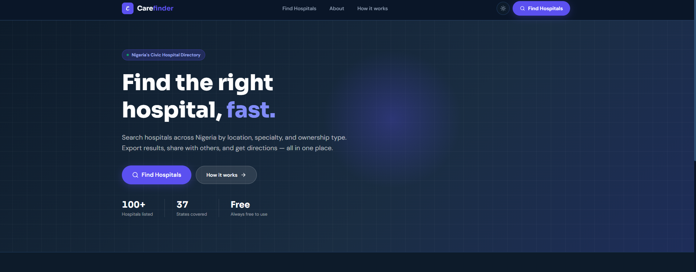
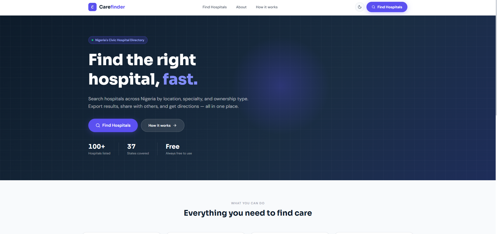
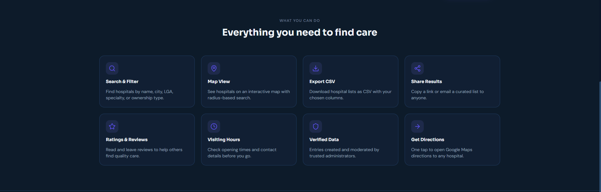
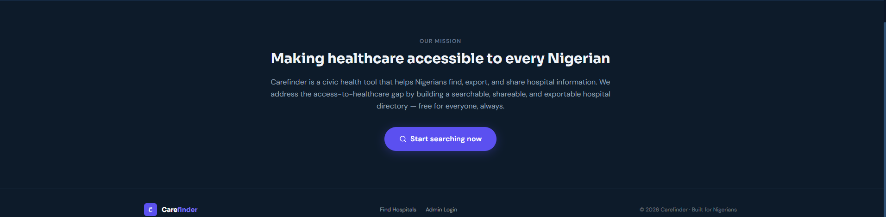
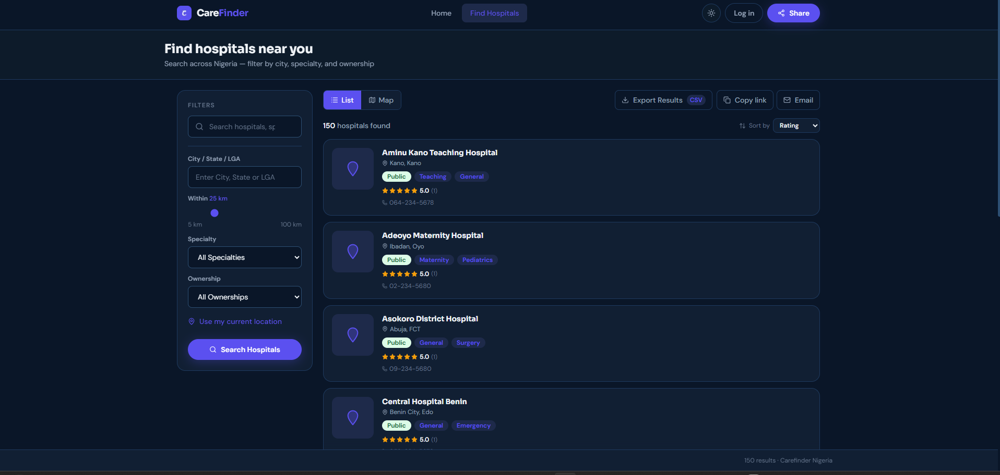
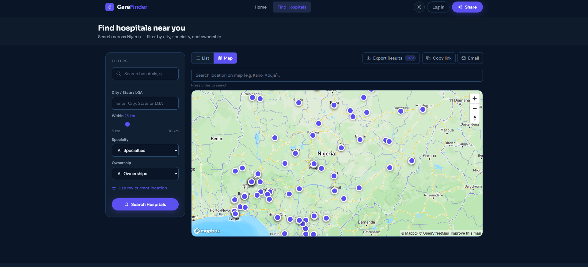
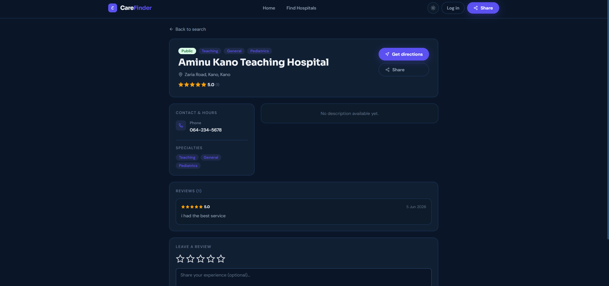
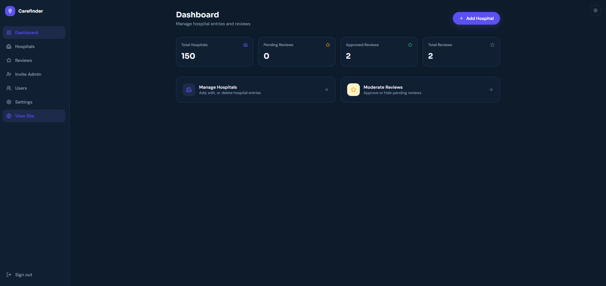
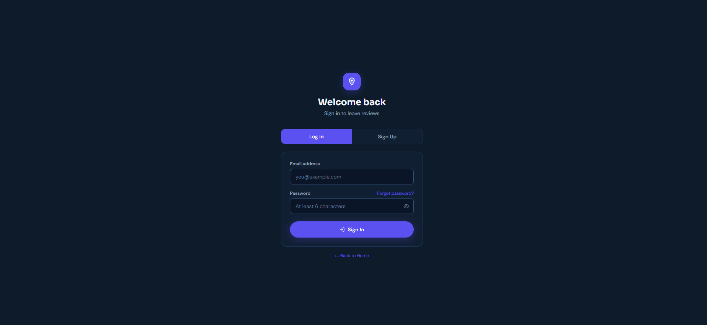

# CAREFINDER

## PROJECT DESCRIPTION

Carefinder is a civic health tool that helps Nigerians find, export, and share hospital information. It addresses a real access-to-healthcare gap by building a searchable, shareable, and exportable hospital directory with role-based admin tools.

The platform distinguishes two audiences: public users who search and share hospital information, and admin users who create and curate hospital entries via a protected dashboard.

🔗 **Live URL:** https://carefinder-gamma.vercel.app  
📦 **GitHub:** https://github.com/Debque/Carefinder

---

## SCREENSHOTS

### Landing Page (Dark Mode)



### Landing Page (Light Mode)



### Features Section



### Mission Section



### Search Page



### Map View



### Hospital Detail Page



### Admin Dashboard



### Login Page



---

## FEATURES

**Public Users**

- Search hospitals by name, city, or Local Government Area (LGA)
- Filter by specialty (maternity, emergency, dental, pediatric, etc.) and ownership type (public/private)
- Interactive Mapbox map with clickable markers, hover popups, and radius-based search
- Browser Geolocation API pre-populates radius search with user's position
- Hospital detail pages with name, address, phone, email, specialties, visiting hours, Markdown description, and ratings
- CSV export with custom column selection — filename includes search query and date
- Share results via copyable URL or email (Resend API)
- 1–5 star ratings with optional text reviews — approved reviews visible to all users
- Dark / Light mode toggle

**Admin Dashboard**

- Create, edit, and delete hospital entries
- Markdown editor with live preview for descriptions
- Image uploads via Supabase Storage
- Review moderation — approve or hide user-submitted reviews
- Admin invite-only — new admins created by existing admins via Supabase Edge Function
- Real-time dashboard stats (total hospitals, pending reviews, approved reviews)

---

## SETUP INSTRUCTIONS

### 1. Clone the repository

```bash
git clone https://github.com/Debque/Carefinder.git
cd Carefinder
```

### 2. Install dependencies

```bash
npm install
```

### 3. Configure environment variables

Create a `.env.local` file in the root:

```env
NEXT_PUBLIC_SUPABASE_URL=your_supabase_url
NEXT_PUBLIC_SUPABASE_ANON_KEY=your_supabase_anon_key
NEXT_PUBLIC_MAPBOX_TOKEN=your_mapbox_token
RESEND_API_KEY=your_resend_api_key
```

### 4. Set up the database

Run the SQL migrations in your Supabase SQL Editor in order:

```
supabase/migrations/001_hospitals.sql
supabase/migrations/002_reviews_images.sql
supabase/migrations/003_rls.sql
```

### 5. Create your first admin account

Sign up at `/login`, then run this in the Supabase SQL Editor:

```sql
UPDATE auth.users
SET raw_app_meta_data = jsonb_set(
  COALESCE(raw_app_meta_data, '{}'),
  '{role}',
  '"admin"'
)
WHERE email = 'your-email@example.com';
```

### 6. Start the development server

```bash
npm run dev
```

Open http://localhost:3000

---

## AVAILABLE SCRIPTS

In the project directory, you can run:

`npm run dev`  
Starts the development server

`npm run build`  
Builds the application for production

`npm run start`  
Starts the production server

`npm run lint`  
Runs ESLint to check for code issues

`npm test`  
Runs unit and component tests with Vitest

`npx playwright test`  
Runs end-to-end tests with Playwright

---

## TECHNOLOGY CHOICES AND REASONING

**Next.js 14 (App Router)**  
Chosen for its server-side rendering, ISR (Incremental Static Regeneration), and edge middleware support. The App Router enables seamless mixing of server and client components.

**Supabase (PostgreSQL + PostGIS)**  
Supabase's PostGIS extension enables geospatial queries — finding hospitals within X km radius. Row Level Security (RLS) natively enforces admin-only writes at the database layer without custom middleware.

**Supabase Auth + RLS**  
Role-based access control enforced at the database layer. Admin role stored in `app_metadata` and verified in both the middleware and Edge Function.

**Mapbox GL JS**  
Used for the interactive hospital map with marker clustering, radius circle overlay, and hover popups. Lazy-loaded with `next/dynamic` to reduce initial bundle size.

**PapaParse**  
Client-side CSV export with zero server roundtrip. Users select which columns to include and the file downloads instantly.

**Resend API**  
Transactional email for hospital list sharing. Used for both the share feature and Supabase Auth custom SMTP.

**Supabase Edge Functions (Deno)**  
Admin invite flow runs as a Deno Edge Function. It verifies the requesting user is an admin, then uses the service role key to call `auth.admin.inviteUserByEmail`.

**React Hook Form + Zod**  
Used for admin entry form validation. Zod schema validates required fields, phone number format, and coordinate bounds.

**Tailwind CSS v4**  
Utility-first styling with CSS variables for theming. Dark and light mode implemented using `.dark` class toggling.

**Vitest + React Testing Library**  
Unit and component testing. 20 tests covering CSV export, search filter logic, distance calculation, Markdown sanitization, and component rendering.

**Playwright**  
End-to-end testing. 7 scenarios covering the full user journey from landing page through search, export, and admin flows.

---

## TESTING

### Unit & Component Tests

```bash
npm test
```

20 tests passing covering:

- CSV column selection and filename format
- PostGIS distance calculation
- Search filter logic (specialty + ownership combos)
- Markdown sanitization (XSS prevention)
- HospitalCard, SearchBar, AdminEntryForm, RatingWidget components

### End-to-End Tests

```bash
npx playwright test
```

7 E2E scenarios:

- Homepage loads with Carefinder branding
- Find Hospitals CTA navigates to search
- Search page loads with correct heading
- Search bar accepts input
- Admin login page loads
- Unauthenticated admin dashboard redirects to login
- Export button opens modal

---

## ARCHITECTURE

```
Browser → Next.js (Vercel Edge Network)
              ↓
    Supabase PostgreSQL + PostGIS
              ↓
    Supabase Storage (hospital images)
              ↓
    Supabase Auth + RLS (role-based access)
              ↓
    Supabase Edge Functions (admin invite)
              ↓
    Resend API (transactional email)
              ↓
    Mapbox GL JS (interactive map)
```

**Key Design Decisions**

- ISR with 60s revalidation on hospital detail pages — admin edits trigger `/api/revalidate`
- `createBrowserClient` from `@supabase/ssr` stores sessions in cookies so server middleware can read auth state
- Mapbox loaded lazily with `next/dynamic` — only initialises when Map tab is clicked
- Approved reviews fetched server-side on the hospital detail page — no auth required to read

---

## DEPLOYMENT

This project is deployed to Vercel with GitHub Actions CI.

On every push to `main`:

1. GitHub Actions runs lint, type check, and build
2. Vercel auto-deploys on success

**Deploy Edge Function manually:**

```bash
supabase functions deploy invite-admin --project-ref YOUR_PROJECT_REF
supabase secrets set SITE_URL=https://carefinder-gamma.vercel.app --project-ref YOUR_PROJECT_REF
```

---

## KNOWN ISSUES

- Distance sort requires user to grant geolocation permission — falls back to name sort if denied
- Email confirmation rate-limited on Supabase free tier (30/hour with custom SMTP)
- Map markers visible only when switching to Map tab — intentional for performance
- `onboarding@resend.dev` sender only delivers to verified Resend account email — production requires a verified domain

---

## FUTURE IMPROVEMENTS

- Verify a custom domain on Resend for unrestricted email delivery
- Add advanced search with multiple specialty selection
- Implement real-time hospital count updates on the landing page
- Add user profile page with review history
- Implement hospital claim/suggest feature for community contributions
- Add print-friendly hospital detail view
- Improve Lighthouse performance score above 80 on mobile
- Add WCAG 2.1 AA keyboard navigation audit

---

## STUDENT INFO

| Field      | Value                    |
| ---------- | ------------------------ |
| Student    | Stella Adegoke           |
| Student ID | ALT/SOE/025/3762         |
| School     | AltSchool of Engineering |
| Cohort     | Karatu 2025              |
| Semester   | Third Semester Capstone  |
| Submitted  | June 7, 2026             |

---

## LICENSE

This project is licensed under the MIT License.

```
MIT License

Copyright (c) 2026 Stella Adegoke

Permission is hereby granted, free of charge, to any person obtaining a copy
of this software and associated documentation files (the "Software"), to deal
in the Software without restriction, including without limitation the rights
to use, copy, modify, merge, publish, distribute, sublicense, and/or sell
copies of the Software, and to permit persons to whom the Software is
furnished to do so, subject to the following conditions:

The above copyright notice and this permission notice shall be included in all
copies or substantial portions of the Software.

THE SOFTWARE IS PROVIDED "AS IS", WITHOUT WARRANTY OF ANY KIND, EXPRESS OR
IMPLIED, INCLUDING BUT NOT LIMITED TO THE WARRANTIES OF MERCHANTABILITY,
FITNESS FOR A PARTICULAR PURPOSE AND NONINFRINGEMENT. IN NO EVENT SHALL THE
AUTHORS OR COPYRIGHT HOLDERS BE LIABLE FOR ANY CLAIM, DAMAGES OR OTHER
LIABILITY, WHETHER IN AN ACTION OF CONTRACT, TORT OR OTHERWISE, ARISING FROM,
OUT OF OR IN CONNECTION WITH THE SOFTWARE OR THE USE OR OTHER DEALINGS IN THE
SOFTWARE.
```
